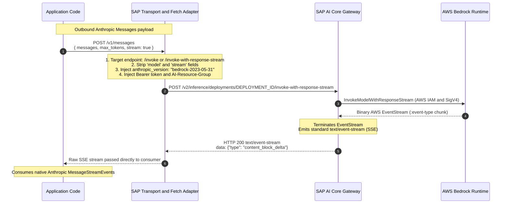

# AWS Bedrock Foundation Model Client: Claude-First via SAP AI Core

## Status

Proposed.

- **Wire protocol**: the AWS Bedrock `invoke` and `invoke-with-response-stream` endpoints.
- **SDK architecture**: Option A, which provides a configured client based on the official `@anthropic-ai/sdk` package adapted for Bedrock `invoke` endpoints through native backend middleware (`SapAnthropic`) and a standalone `fetch` adapter (`createSapBedrockAnthropicFetch`).
  This approach directly continues the strategy established in [ADR 007: Foundation Model Client Strategy](./007-foundation-model-client-strategy.md) and implemented in the `@sap-ai-sdk/openai` package.

---

## Context

The `@sap-ai-sdk/core` package declares the `AwsBedrockChatModel` and `AwsBedrockEmbeddingModel` types, but the `@sap-ai-sdk/foundation-models` package ships only the original handwritten Azure OpenAI client (`AzureOpenAiChatClient` class).

In [ADR 007: Foundation Model Client Strategy](./007-foundation-model-client-strategy.md), client architectures were evaluated and the decision was made to move away from handwriting clients with auto-generated OpenApi types (Option A in ADR 007).
Instead, ADR 007 established the strategy of providing configured clients based on official provider SDKs (Option B.2 in ADR 007), which was realized in the `@sap-ai-sdk/openai` package.

This ADR addresses native Claude support through AWS Bedrock on SAP AI Core, aligning with the principles of ADR 007 in the following areas:

1. **Wire protocol and endpoint selection**: how requests are routed and serialized to the AWS Bedrock executable in SAP AI Core.
2. **SDK client architecture**: how the client is exposed to developers, building on the precedent of the `@sap-ai-sdk/openai` package.

---

## Part 1: Wire Protocol and Endpoint Selection

AWS Bedrock and SAP AI Core expose three potential integration paths for Anthropic Claude:

Proposed Integration Paths for Anthropic Claude:

- Option A: Dedicated Messages API
- Option B: Converse API
- Option C: Invoke API

Decision: Option C (Invoke API) is proposed as the preferred integration path due to its near-zero wire impedance with the Anthropic Messages API.

### Option A: Dedicated Messages API: Preferred, Not Yet Available

A dedicated `/v1/messages` endpoint provides first-party Claude parity without URL or payload adaptations.
However, SAP AI Core does not expose a dedicated messages route for Bedrock deployments.

### Option B: Converse API: Rejected

Bedrock's `converse` and `converse-stream` operations attempt to harmonize payloads across diverse foundation model vendors (such as Amazon Titan, Amazon Nova, and Anthropic Claude).
These operations present the following disadvantages:

- **High schema impedance**: replaces Anthropic message schemas with AWS-specific envelope structures, such as `messages: [{ role, content: [{ text }] }]`.
- **Streaming protocol incompatibility**: SAP AI Core emits `text/event-stream` server-sent events (SSE) for the `/converse-stream` endpoint, whereas AWS Bedrock SDKs (such as the `@ai-sdk/amazon-bedrock` package) expect binary AWS EventStream framing (`application/vnd.amazon.eventstream`).
  Reusing AWS tooling requires a complex SSE-to-binary EventStream transformer.

### Option C: Invoke API: Proposed Choice

The `invoke` operation is Bedrock's model-native runtime operation.
For Anthropic Claude, Anthropic and AWS designed the `invoke` request and response payload to be nearly identical to the Anthropic Messages API:

#### Reasons for Minimal Wire Impedance

The wire impedance is minimal for the following reasons:

1. **Identical request schemas**: the `messages`, `system`, `tools`, `tool_choice`, `temperature`, and `max_tokens` parameters are identical between the Anthropic Messages API and the Bedrock Claude `invoke` operation.
2. **Identical response schemas**: the synchronous `/invoke` endpoint returns the exact Anthropic `Message` JSON structure, including the `id`, `type`, `role`, `content`, `stop_reason`, and `usage` properties.
3. **SAP AI Core SSE advantage**: on native AWS Bedrock, streaming emits binary AWS EventStream frames wrapping Base64 blobs.
   SAP AI Core unpacks these frames and emits standard text SSE (`text/event-stream`), matching the SSE event payload format of Anthropic (`message_start`, `content_block_delta`, `message_delta`, etc.).
   _(Note: SAP AI Core Bedrock emits `data: {"type": ...}` blocks without `event: <type>` headers; see Stream Normalization in Part 2 for the adapter normalization)._

The required payload adaptation in the transport layer requires about 15 lines of code to perform the following steps:

1. Route to the `/invoke` or `/invoke-with-response-stream` endpoint.
2. Strip the `model` and `stream` parameters, because the SAP AI Core deployment and endpoint URL handle selection.
3. Add `"anthropic_version": "bedrock-2023-05-31"` to the JSON request body.
4. Set the `Authorization: Bearer AI_CORE_TOKEN` header and the `AI-Resource-Group: RESOURCE_GROUP` header.

---

## Part 2: SDK Architecture and Client Options

The following five SDK implementation options were investigated:

1. Configure the `@anthropic-ai/sdk` package via backend middleware and a custom `fetch` adapter (Option A).
2. Use the AWS SDK `BedrockRuntimeClient` class with the `invoke` operation (Option B).
3. Use higher-level frameworks such as Vercel or LangChain (Option C).
4. Generate a client from an OpenApi specification (Option D).
5. Use official types with a handwritten SAP transport (Option E).

### Option A: Configure `@anthropic-ai/sdk` for Bedrock Invoke (Proposed Choice)

- **Mechanism**: follow the precedent set by the `@sap-ai-sdk/openai` package.
  Instantiate or subclass the official `Anthropic` class from the `@anthropic-ai/sdk` package configured with a custom `fetch` function and base URL.
  The custom `fetch` function performs deployment URL routing, header injection, parameter stripping for the `model` and `stream` properties, and injection of the `anthropic_version` property.
- **Alignment with ADR 007**: matches Option B.2 of [ADR 007: Foundation Model Client Strategy](./007-foundation-model-client-strategy.md) directly.
  By wrapping the official vendor client, developers receive day-0 feature access for all Claude capabilities, provider TypeScript types, full streaming helpers (such as the `stream()` method), prompt caching, tool use, and minimal maintenance overhead.

Option A provides the following advantages:

- Requires zero handwritten response wrappers or stream accumulators.
- Provides a consistent developer experience with the `@sap-ai-sdk/openai` package.
- Inherits upstream enhancements and bug fixes directly from Anthropic.

#### Architecture: Middleware or Fetch-Based Adapter

Rather than forcing a fetch monkey-patch, Stainless (`@anthropic-ai/sdk`) provides dedicated backend extension hooks:

1. **Native `backendMiddleware` hook**:
   - `SapAnthropic` subclasses `Anthropic` and overrides `backendMiddleware()`.
   - **Canonical Request Visibility**: Any user-defined middleware or telemetry observes standard Anthropic-shaped requests (`/v1/messages`, `model` parameter, etc.) before the backend adapter translates it for AWS Bedrock.
   - **Typed Execution Context**: Provides access to `ctx.options?.stream` without needing to parse the raw body string twice.
   - **Stream Normalization**: SAP AI Core Bedrock emits SSE `data: {"type": ...}` blocks without `event: <type>` headers.
     Anthropic's SDK SSE parser strictly requires `event: ...`. `adaptBedrockSseStream` injects missing `event:` headers into the stream, enabling full support for `messages.stream()` (`runner.on('text')`, `runner.finalMessage()`, etc.).
   - **Bearer Token Management**: Seamlessly uses Anthropic's `credentials: AccessTokenProvider` with `expiresAt: 0`, delegating token caching and refresh to `@sap-ai-sdk/core` / SAP Cloud SDK.

2. **Standalone Fetch Adapter (`createSapBedrockAnthropicFetch`)**:
   - Included alongside the class implementation (referencing the pattern from `direct-access-vercel/src/authenticated-fetch.ts`) for environments that prefer configuring standard `new Anthropic({ fetch })`.

### Option B: Use AWS SDK (`@aws-sdk/client-bedrock-runtime`) with Invoke

- **Mechanism**: use the `BedrockRuntimeClient` class with the `InvokeModelCommand` command and custom middleware for path rewriting and Bearer tokens.
- **Status**: rejected.

Option B was rejected for the following reasons:

1. **Streaming failure**: the `InvokeModelWithResponseStreamCommand` command strictly expects binary AWS EventStream framing from the `@smithy/eventstream-codec` package.
   When SAP AI Core emits text SSE, the AWS SDK throws the error "Truncated event message received: Deserialization error".
2. **Lack of Claude types**: the `InvokeModelCommandInput.body` property and output bodies are raw `Uint8Array` blobs.
   Developers receive no typed Claude models, tool helpers, or stream accumulators.

### Option C: Higher-Level Multi-Model SDKs (Vercel AI SDK or LangChain)

- **Mechanism**: use the `@ai-sdk/anthropic`, `@ai-sdk/amazon-bedrock`, or `@langchain/anthropic` package.
- **Status**: considered.

Option C presents the following advantages:

- Provides a higher-level abstraction.
- Expresses an API-neutral approach to exposing Claude capabilities.
- Avoids additional effort for eventual support in those agent SDKs.

Option C presents the following disadvantages:

- Imposes external opinionated abstractions.
- Model-specific innovations (such as thinking budgets and cache breakpoints) are gated by upstream releases.

### Option D: Generate Client from OpenApi Specification

- **Status**: rejected.

AWS Bedrock does not publish an OpenApi specification for runtime model payloads.
Models use untyped binary blobs in AWS Smithy definitions.
SAP AI Core does not publish model-specific Bedrock schemas.

### Option E: Official Types with Handwritten SAP Transport (`executeRequest()` Function and `SseStream` Class)

- **Mechanism**: handwrite a client class (`AwsBedrockClaudeChatClient`) using imported Anthropic types, executing requests through the `@sap-ai-sdk/core` package (the `executeRequest()` function and the `SseStream` class).
- **Status**: rejected.

While this approach mirrors the legacy `AzureOpenAiChatClient` class in the `@sap-ai-sdk/foundation-models` package, it suffers from the drawbacks that prompted ADR 007.
Handwriting clients requires implementing and maintaining response classes, stream chunk accumulators (merging deltas into text and tool calls), and perpetual manual synchronization with Anthropic's rapidly evolving API.

---

## Detailed Evaluation and Core Questions

### How feasible is adding deployment resolution to each option?

Deployment resolution is highly feasible across all options.
The `@sap-ai-sdk/ai-api` package provides the `resolveDeploymentUrlForModel(deployment, { scenarioId: 'foundation-models', executableId: 'aws-bedrock', resourceGroup, destination })` function.

The options evaluate as follows:

- **Option A**: highly straightforward, matching the `SapAzureOpenAi` class in the `@sap-ai-sdk/openai` package.
  The client constructor resolves the deployment URL and destination token, injecting them into the custom `fetch` function or request pipeline.
- **Option B (AWS SDK)**: cumbersome, because it requires dummy model IDs and middleware path rewriting to override the regional AWS endpoint.

### Which SDK is the best option to explore Claude features fully?

The selected choice is the `@anthropic-ai/sdk` package (Option A).

The `@anthropic-ai/sdk` package is Anthropic's flagship development surface with immediate support for prompt caching, extended thinking, multi-turn tool calling, and multi-modal inputs.
In contrast, the `@aws-sdk/client-bedrock-runtime` package provides no Claude abstractions, and the `@anthropic-ai/bedrock-sdk` package is tailored for AWS SigV4 IAM authentication rather than the OAuth2 Bearer gateway of SAP AI Core.

### Do SAP AI Core deployments have limitations when used with these SDKs?

Model-level limitations exist on earlier Claude 3 and Claude 3.5 releases:

- **Extended thinking**: gated to Claude 3.7 Sonnet or later; earlier models reject thinking parameters.
- **Maximum output tokens**: Claude 3 models are capped at 4,096 tokens (compared to 8,192 or more tokens on subsequent revisions).
- **Prompt caching**: supported on Bedrock `invoke` through explicit breakpoints (`cache_control: { type: "ephemeral" }`), but automatic caching is restricted to later models and specific regions.
- **Computer use**: beta feature with restricted deployment availability.

The following features function consistently on earlier models through Bedrock `invoke`:

- System prompts.
- Multi-turn conversations.
- Tool use (function calling).
- Image vision inputs.

### How complete is SAP AI Core feature coverage for each SDK?

The integration with SAP AI Core exhibits the following characteristics:

- **Streaming protocol**: SAP AI Core terminates Bedrock's binary EventStream and serves text SSE.
  This behavior breaks AWS SDK tools, but aligns directly with the native SSE parser of the `@anthropic-ai/sdk` package.
- **Authentication**: SAP AI Core replaces AWS SigV4 signing with standard OAuth2 Bearer tokens and the `AI-Resource-Group` header.
- **Model routing**: the SAP AI Core deployment URL isolates model selection.
  The request body `model` parameter is discarded, and `"anthropic_version": "bedrock-2023-05-31"` is added to the payload.

---

## Decision

The architecture decision encompasses the following points:

1. **Wire protocol**: standardize on the AWS Bedrock `invoke` (synchronous) and `invoke-with-response-stream` (streaming) endpoints through SAP AI Core deployments.
2. **Client architecture**: adopt Option A.
   Provide a configured client based on the official `@anthropic-ai/sdk` package (mirroring the architecture of the `@sap-ai-sdk/openai` package).
   Rather than forcing a fetch monkey-patch, Stainless provides dedicated backend extension hooks:
   - Provide `SapAnthropic` subclassing `Anthropic` and overriding `backendMiddleware()` for canonical request visibility, typed execution context, stream normalization (`adaptBedrockSseStream`), and Bearer token management via `credentials: AccessTokenProvider`.
   - Provide a standalone fetch adapter (`createSapBedrockAnthropicFetch`) alongside `SapAnthropic` for environments that prefer configuring standard `new Anthropic({ fetch })`.
     This approach delivers complete, day-0 Claude feature coverage, provider TypeScript types, and streaming helpers without handwriting response accumulators or maintaining parallel schemas.
3. **Rejection of Option B**: reject Option B (the `@aws-sdk/client-bedrock-runtime` package) due to binary EventStream deserialization failures on SAP AI Core SSE responses and the lack of Claude types.
4. **Rejection of Option E**: reject Option E (handwritten client), adhering to the strategy established in [ADR 007: Foundation Model Client Strategy](./007-foundation-model-client-strategy.md) to avoid handwriting client code and response accumulators.

---

## Sources

The following resources provide background information and technical context:

- [ADR 007: Foundation Model Client Strategy](./007-foundation-model-client-strategy.md)
- [Backlog Issue: Write Bedrock Foundation Models ADR (including linked PoCs)](https://github.com/SAP/ai-sdk-js-backlog/issues/698)
- [API compatibility by model: Amazon Bedrock](https://docs.aws.amazon.com/bedrock/latest/userguide/models-api-compatibility.html)
- [Claude in Amazon Bedrock: Anthropic Documentation](https://platform.claude.com/docs/en/build-with-claude/claude-in-amazon-bedrock)
- [Anthropic Claude Tool Use on Amazon Bedrock](https://docs.aws.amazon.com/bedrock/latest/userguide/model-parameters-anthropic-claude-messages-tool-use.html)
- Reference prototype in the `sap-bedrock-wrapper` repository (`prototype/sap-bedrock-runtime.prototype.ts` file)
- Reference direct access implementation in the `direct-access-vercel` repository (`src/authenticated-fetch.ts` file)
