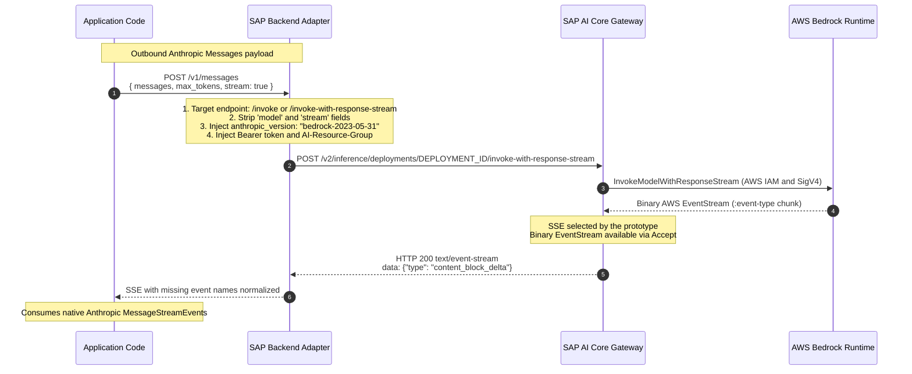

# AWS Bedrock Foundation Model Client: Claude-First via SAP AI Core

## Status

Proposed.

The proposal comprises the following selections:

- **Wire protocol**: the AWS Bedrock `invoke` and `invoke-with-response-stream` endpoints.
- **SDK architecture**: option A, which provides a configured client based on the official `@anthropic-ai/sdk` package adapted for Bedrock `invoke` endpoints through native backend middleware (the `SapAnthropic` class) and a standalone `fetch` adapter (the `createSapBedrockAnthropicFetch()` function).
  This approach directly continues the strategy established in [ADR 007: Foundation Model Client Strategy](./007-foundation-model-client-strategy.md) and implemented in the `@sap-ai-sdk/openai` package.

---

## Context

The `@sap-ai-sdk/core` package declares the `AwsBedrockChatModel` and `AwsBedrockEmbeddingModel` types, but the `@sap-ai-sdk/foundation-models` package ships only the original handwritten Azure OpenAI client (`AzureOpenAiChatClient` class).

In [ADR 007: Foundation Model Client Strategy](./007-foundation-model-client-strategy.md), client architectures were evaluated and the decision was made to move away from handwriting clients with auto-generated OpenApi types (Option A in ADR 007).
Instead, ADR 007 established the strategy of providing configured clients based on official provider SDKs (Option B.2 in ADR 007), which was realized in the `@sap-ai-sdk/openai` package.

This ADR addresses native Claude support through AWS Bedrock on SAP AI Core, aligning with the principles of ADR 007 in the following areas:

- **Wire protocol and endpoint selection**: how requests are routed and serialized to the AWS Bedrock executable in SAP AI Core.
- **SDK client architecture**: how the client is exposed to developers, building on the precedent of the `@sap-ai-sdk/openai` package.

---

## Part A: Wire Protocol and Endpoint Selection

AWS Bedrock and SAP AI Core expose three potential integration paths for Anthropic Claude:

- Option A: Dedicated Messages API
- Option B: Converse API
- Option C: Invoke API

Decision: Option C (Invoke API) is proposed as the preferred integration path due to its near-zero wire impedance with the Anthropic Messages API.

### Option A: Dedicated Messages API: Preferred, Not Yet Available on SAP AI Core

A dedicated Messages endpoint minimizes URL and payload adaptations.
AWS now documents a separate Bedrock Mantle endpoint at `/anthropic/v1/messages`, with native Messages request shapes and SSE streaming, and Anthropic provides separate `AnthropicBedrockMantle` class clients for it.
SAP AI Core does not yet expose this route for Bedrock deployments.
Exposure on SAP AI Core has been indicated as likely.
The proposal therefore targets the available deployment-local Invoke and Converse endpoints.
See [Claude in Amazon Bedrock](https://platform.claude.com/docs/en/build-with-claude/claude-in-amazon-bedrock) for the AWS-side Messages integration.

### Option B: Converse API: Viable Alternative

Bedrock's `converse` and `converse-stream` operations harmonize payloads across foundation model vendors, including Amazon Nova and Anthropic Claude.
The official `@aws-sdk/client-bedrock-runtime` package provides typed request bodies, responses, and streaming events for these operations, unlike the opaque model-specific bodies of `invoke`.
Converse is therefore a viable choice for a harmonized, multi-model API.

For this Claude-first proposal, the trade-off is the use of AWS-specific schemas, such as `messages: [{ role, content: [{ text }] }]`, rather than native Anthropic Messages schemas and SDK helpers.
Invoke remains the proposed choice for preserving that native Claude surface; Converse is not excluded by a streaming transport limitation.

#### Streaming Content Negotiation

SAP AI Core supports both SSE and binary AWS EventStream responses.
For `/converse-stream`, a request with the default `Accept: */*` returns `text/event-stream`, while sending `Accept: application/vnd.amazon.eventstream` returns native binary AWS EventStream.
The official JavaScript AWS SDK can deserialize the negotiated binary response without an SSE-to-EventStream transformer.
The same explicit header also enables native AWS SDK decoding for `/invoke-with-response-stream`.

The [Python Bedrock adapter](https://github.com/SAP/ai-sdk-python/blob/os-migration/packages/gen/gen_ai_hub/proxy/native/amazon/clients.py) sets this `Accept` header in the `prepare_request_dict()` method and delegates both synchronous and asynchronous Converse streaming to the official clients.
The JavaScript adapter can apply the same header through the `client.middlewareStack.add()` method, alongside deployment path rewriting and SAP headers.
This is http response content negotiation, not a custom streaming protocol; the compatibility gotcha is that the AWS client does not otherwise need to request its native streaming format explicitly.

### Option C: Invoke API: Proposed Choice

The `invoke` operation is Bedrock's model-native runtime operation.
For Anthropic Claude, Anthropic and AWS designed the `invoke` request and response payload to be nearly identical to the Anthropic Messages API:

The following diagram shows the SSE-based prototype, not a required production streaming implementation.

#### Reasons for Minimal Wire Impedance

The wire impedance is minimal for the following reasons:

- **Near-native request schemas**: core fields such as `messages`, `system`, `tools`, `tool_choice`, and `max_tokens` retain Anthropic's shapes, with Bedrock-specific routing and version adaptation.
  This is not an unconditional guarantee that every first-party parameter or beta feature is accepted by every Bedrock model.
- **Native message response schema**: synchronous Claude Invoke responses retain Anthropic's `Message` structure, including `id`, `type`, `role`, `content`, `stop_reason`, and `usage`, rather than a Converse envelope.
- **SAP AI Core SSE option**: on native AWS Bedrock, streaming emits binary AWS EventStream frames containing model-native payloads.
  When binary EventStream is not requested, SAP AI Core emits text SSE (`text/event-stream`), matching Anthropic's event payload format (`message_start`, `content_block_delta`, `message_delta`, etc.).
  SAP AI Core's SSE response omits `event: <type>` names; the prototype adds them, but this normalization is not needed when reusing SDK support for binary AWS EventStream.

The adapter has the following responsibilities, with provider-specific request adaptation delegated to existing Bedrock SDK support where possible:

1. Route to the `/invoke` or `/invoke-with-response-stream` endpoint.
2. Strip the `model` and `stream` parameters, because the SAP AI Core deployment and endpoint URL handle selection.
3. Add `"anthropic_version": "bedrock-2023-05-31"` to the JSON request body.
4. Set the `Authorization: Bearer AI_CORE_TOKEN` header and the `AI-Resource-Group: RESOURCE_GROUP` header.
5. For streaming, send `Accept: application/vnd.amazon.eventstream` and reuse existing Bedrock SDK EventStream decoding rather than implementing a custom SSE normalizer.

---

## Part B: SDK Architecture and Client Options

The following five SDK implementation options were investigated:

- Configure the `@anthropic-ai/sdk` package via backend middleware and a custom `fetch` adapter (Option A).
- Use the AWS SDK `BedrockRuntimeClient` class with Invoke or Converse operations (Option B).
- Use higher-level frameworks such as Vercel or LangChain (Option C).
- Generate a client from an OpenApi specification (Option D).
- Use official types with a handwritten SAP transport (Option E).

### Option A: Configure `@anthropic-ai/sdk` for Bedrock Invoke (Proposed Choice)

- **Mechanism**: follow the configured-provider-client precedent set by the `@sap-ai-sdk/openai` package.
  Use the official Anthropic client's backend extension hooks with the resolved deployment base URL; the prototype demonstrates this through the `backendMiddleware()` method of the `SapAnthropic` class.
  The backend adapter supplies SAP routing and headers, while existing Bedrock SDK support should own provider-specific payload adaptation and EventStream response decoding where possible.
  A custom `fetch` adapter is an alternative configuration mechanism, which enables use of the official `Anthropic` class with `new Anthropic({ fetch })`.
- **Alignment with ADR 007**: matches Option B.2 of [ADR 007: Foundation Model Client Strategy](./007-foundation-model-client-strategy.md) directly.
  By wrapping the official vendor client, developers receive upstream Claude types and helpers, including the `messages.stream()` method, without waiting for this package to recreate them.
  Actual feature availability still depends on the selected model, Bedrock API, region, and SAP AI Core deployment.

Option A provides the following advantages:

- Requires zero handwritten response wrappers or stream accumulators.
- Provides a consistent developer experience with the `@sap-ai-sdk/openai` package.
- Inherits upstream enhancements and bug fixes directly from Anthropic.

#### Architecture: Middleware or Fetch-Based Adapter

The precedent is adapting an official provider client, not using an identical extension hook across SDKs.
The `@sap-ai-sdk/openai` package already overrides the [`buildRequest()`](../packages/openai/src/azure-openai.ts) method of the `SapAzureOpenAi` class, rather than monkey-patching fetch.
For Anthropic, the `backendMiddleware()` method is preferred over a `buildRequest()` method override because it runs inside user middleware and can adapt both the outgoing request and incoming streaming response while keeping user middleware's view in the canonical Anthropic shape.

The adapter architecture includes the following configuration options:

- **Native `backendMiddleware()` method hook**:
  - The prototype's `SapAnthropic` class subclasses the `Anthropic` class and overrides the `backendMiddleware()` method.
  - **Canonical request visibility**: user-defined middleware observes standard Anthropic-shaped requests (`/v1/messages`, `model` parameter, etc.) before the backend adapter translates them for AWS Bedrock.
  - **Typed execution context**: provides access to the `ctx.options?.stream` property without needing to parse the raw body string twice.
  - **Streaming support**: production should negotiate binary AWS EventStream and reuse existing Bedrock SDK decoding, preserving Anthropic's typed events and streaming helpers without a custom SSE normalizer.
    The SSE-based prototype uses the `adaptBedrockSseStream()` function to inject the missing `event:` names required by Anthropic's SSE parser; this demonstrates `messages.stream()` method support but is not a production requirement.
  - **Bearer token management**: seamlessly uses Anthropic's `credentials: AccessTokenProvider` property with `expiresAt: 0`, delegating token caching and refresh to `@sap-ai-sdk/core` / SAP Cloud SDK.

- **Standalone fetch adapter (the `createSapBedrockAnthropicFetch()` function)**:
  - Included alongside the class implementation (referencing the pattern from `direct-access-vercel/src/authenticated-fetch.ts`) for environments that prefer configuring standard `new Anthropic({ fetch })`.

### Option B: Use AWS SDK (`@aws-sdk/client-bedrock-runtime`) with Invoke or Converse

- **Mechanism**: use the `BedrockRuntimeClient` class with the `InvokeModelCommand`, `InvokeModelWithResponseStreamCommand`, `ConverseCommand`, or `ConverseStreamCommand` classes.
  Configure SAP bearer authentication through `token` and `authSchemePreference: ['httpBearerAuth']` instead of SigV4.
  Use the `client.middlewareStack.add()` method to rewrite `/model/{modelId}/{operation}` to the deployment-local operation path, inject SAP headers, and set `Accept: application/vnd.amazon.eventstream` for streaming operations.
- **Status**: technically viable; not selected for the proposed Claude-first client surface.

The AWS SDK owns request serialization, response deserialization, and binary EventStream decoding.
SAP AI Core's default SSE response differs from the binary AWS EventStream expected by the SDK; explicitly negotiating `application/vnd.amazon.eventstream` resolves this transport mismatch.
Live verification on a Claude Sonnet 4.6 deployment confirmed non-streaming and streaming Invoke and Converse through the official JavaScript AWS client, without an SSE bridge or custom EventStream parser.

The remaining trade-offs are API-level:

- **Invoke lacks model-specific types and helpers**: its body is an opaque model-native payload, and the SDK does not supply native Claude request/response types or Anthropic stream accumulators.
- **Converse supplies harmonized types**: its request, response, and event schemas are typed, but differ from native Anthropic Messages schemas and do not provide the Anthropic SDK's message-stream helpers.

### Option C: Higher-Level Multi-Model SDKs (Vercel SDK or LangChain)

- **Mechanism**: use framework Bedrock integrations such as `@ai-sdk/amazon-bedrock` or `@langchain/aws`, rather than exposing the official provider client directly.
- **Status**: considered.

Option C presents the following advantages:

- Provides a higher-level abstraction.
- Expresses an API-neutral approach to exposing Claude capabilities.
- Avoids additional effort for eventual support in those agent SDKs.

Option C presents the following disadvantages:

- Imposes external opinionated abstractions.
- Model-specific innovations (such as thinking budgets and cache breakpoints) are gated by upstream releases.

### Option D: Generate Client from OpenApi Specification

- **Status**: rejected.

AWS Bedrock does not publish an OpenApi specification for runtime model payloads.
Models use untyped binary blobs in AWS Smithy definitions.
SAP AI Core does not publish model-specific Bedrock schemas.

### Option E: Official Types with Handwritten SAP Transport (`executeRequest()` Function and `SseStream` Class)

- **Mechanism**: handwrite a client class (`AwsBedrockClaudeChatClient`) using imported Anthropic types, executing requests through the `@sap-ai-sdk/core` package (the `executeRequest()` function and the `SseStream` class).
- **Status**: rejected.

While this approach mirrors the legacy `AzureOpenAiChatClient` class in the `@sap-ai-sdk/foundation-models` package, it suffers from the drawbacks that prompted ADR 007.
Handwriting clients requires implementing and maintaining response classes, stream chunk accumulators (merging deltas into text and tool calls), and perpetual manual synchronization with Anthropic's rapidly evolving API.

---

## Ecosystem Research: Native Claude and Unified Bedrock APIs

The following comparison was checked against primary SDK sources and provider documentation on 2026-10-13.
It distinguishes the existing Bedrock runtime APIs from the separate Bedrock Mantle Messages integration; it does not assert that all Bedrock clients use Invoke.

### Official Anthropic Bedrock runtime Clients

The TypeScript [`AnthropicBedrock` class implementation in `@anthropic-ai/bedrock-sdk`](https://github.com/anthropics/anthropic-sdk-typescript/blob/main/packages/bedrock-sdk/src/client.ts) and Python [`anthropic.AnthropicBedrock` class implementation](https://github.com/anthropics/anthropic-sdk-python/blob/main/src/anthropic/lib/bedrock/_client.py), installed with `anthropic[bedrock]`, route message generation to `InvokeModel` and `InvokeModelWithResponseStream`, not Converse.
Both add `anthropic_version: "bedrock-2023-05-31"`, remove the routing fields `model` and `stream`, and translate the canonical Messages path to the selected Invoke endpoint.
They also translate Anthropic beta headers into Bedrock payload fields where applicable.
The base `@anthropic-ai/sdk` package is not made into a Bedrock client by authentication alone; this proposal's `SapAnthropic` class supplies the routing and response adaptation through the `backendMiddleware()` method.

This supports the Claude-first choice for three reasons:

- **Schema fidelity**: native Anthropic message, tool, and content-block shapes are preserved without translating them into Converse envelopes.
- **Upstream feature exposure**: model-native options such as `cache_control`, thinking configuration, computer-use tools, document/image inputs, and structured-output settings can use Anthropic's SDK surface when supported by the target deployment, rather than requiring a new harmonized field in this wrapper.
  Invoke avoids an additional Converse-schema translation step, but does not guarantee day-0 feature availability on Bedrock or SAP AI Core.
- **Native types and helpers**: Anthropic's SDK supplies typed messages and stream events, text callbacks, final-message accumulation, and usage accumulation.
  The official Bedrock runtime clients decode binary AWS EventStream into Anthropic event semantics, which the production adapter should reuse.
  The prototype's alternative SSE normalization is not a requirement of the proposed architecture.
  Payload compatibility does not mean the original AWS streaming wire format is SSE.

Anthropic's [Bedrock runtime documentation](https://platform.claude.com/docs/en/build-with-claude/claude-on-amazon-bedrock-legacy) describes this integration separately from the Bedrock Mantle Messages endpoint.
Model, endpoint, and feature availability must be checked independently of SDK type availability.

### AWS SDK: Model-Native Payloads or Harmonized Types

The AWS SDK and boto3 expose both API families.
Invoke carries a model-specific body: for Claude, the JavaScript SDK sends Anthropic JSON as an opaque payload and does not supply Claude-specific body types.
Converse supplies typed AWS message, tool, response, and event schemas for a consistent interface across supported model providers.
[AWS documents Converse](https://docs.aws.amazon.com/bedrock/latest/APIReference/API_runtime_Converse.html) as a way to write code once and use it with different models; it is also a valid choice for a Claude-only application that prefers that interface.

Converse exposes model-specific request parameters through `additionalModelRequestFields`.
For model-specific response data, callers request JSON Pointer paths through `additionalModelResponseFieldPaths`, and the returned data appears in `additionalModelResponseFields`.
These extension fields preserve access to supported native parameters, but do not give the caller Anthropic's model-specific TypeScript types or message-stream helpers.
They are a schema trade-off, not proof that a feature is unavailable through Converse.

For example, AWS documents [prompt caching for both Invoke and Converse](https://docs.aws.amazon.com/bedrock/latest/userguide/prompt-caching.html), and LangChain documents [extended thinking through Converse](https://docs.langchain.com/oss/python/integrations/chat/bedrock#extended-thinking) using `additional_model_request_fields`.
The Converse API also defines `outputConfig` for supported structured-output configurations.
Both AWS streaming API families use binary AWS EventStream; through AI Core, the adapter must explicitly negotiate that format as described in Part A.

### Third-Party Frameworks

Frameworks expose both model-native and unified paths; there is no universal rule that Claude must use Invoke or that Converse is only appropriate for multi-provider workloads.

| Framework                                                                            | Unified Bedrock path                                                                                                                         | Native Claude / Invoke path                                                                                                                                                                                                                    |
| ------------------------------------------------------------------------------------ | -------------------------------------------------------------------------------------------------------------------------------------------- | ---------------------------------------------------------------------------------------------------------------------------------------------------------------------------------------------------------------------------------------------- |
| [Vercel SDK](https://ai-sdk.dev/providers/ai-sdk-providers/amazon-bedrock)           | The generic `@ai-sdk/amazon-bedrock` provider uses Converse.                                                                                 | `bedrockAnthropic` / `createBedrockAnthropic` from `@ai-sdk/amazon-bedrock/anthropic` uses InvokeModel and exposes Anthropic-oriented caching, thinking, and computer-use options. The documented API is not the `bedrock.anthropic()` method. |
| [LangChain Python](https://docs.langchain.com/oss/python/integrations/chat/bedrock)  | `ChatBedrockConverse` supplies the Converse integration; documentation recommends it for supported workloads that do not need custom models. | `ChatBedrock` retains model-specific invocation, with an optional Converse switch; `ChatAnthropicBedrock` extends `ChatAnthropic` through the official Anthropic Bedrock client.                                                               |
| [LiteLLM](https://docs.litellm.ai/docs/providers/bedrock#set-converse--invoke-route) | `bedrock/converse/<model>` explicitly selects Converse.                                                                                      | `bedrock/invoke/<model>` explicitly selects Invoke. Bare `bedrock/<model>` routing depends on the supported model and configuration, so it should not be treated as an unconditional Invoke route.                                             |

### Implication for This Proposal

Prefer Invoke with Anthropic's SDK when the goal is a Claude-first surface with native schemas, types, and stream helpers.
Prefer Converse when the application values AWS's harmonized, typed interface and provider interchangeability, or prefers that interface for Claude.
The proposed choice is an API-surface decision, not a streaming-compatibility workaround or a guarantee of exclusive Claude feature coverage.

---

## Detailed Evaluation and Core Questions

### How feasible is adding deployment resolution to each option?

Deployment resolution is highly feasible across all options.
The `@sap-ai-sdk/ai-api` package provides the `resolveDeploymentUrlForModel(deployment, { scenarioId: 'foundation-models', executableId: 'aws-bedrock', resourceGroup, destination })` function.

The options evaluate as follows:

- **Option A**: highly straightforward, matching the `SapAzureOpenAi` class in the `@sap-ai-sdk/openai` package.
  The client constructor resolves the deployment URL and destination token, injecting them into the custom `fetch` function or request pipeline.
- **Option B (AWS SDK)**: feasible with an internal placeholder model ID and build middleware that removes the generated `/model/{modelId}` path segment, injects SAP headers, and negotiates binary EventStream for streaming operations.

### Which SDK is the best option to explore Claude features fully?

The selected choice is the `@anthropic-ai/sdk` package (Option A).

The `@anthropic-ai/sdk` package is Anthropic's native development surface for Claude types, message-stream helpers, and model-specific parameters.
Using it avoids recreating that surface in the SAP wrapper; supported runtime features remain constrained by the selected Bedrock model and SAP AI Core deployment.
In contrast, the `@aws-sdk/client-bedrock-runtime` package provides typed, harmonized Converse schemas but no native Claude types or Anthropic stream helpers for Invoke.
The `@anthropic-ai/bedrock-sdk` package adds AWS routing, bearer-token or SigV4 authentication, and EventStream response adaptation.
It is not inherently incompatible with bearer authentication; SAP deployment routing, token resolution, and resource-group headers still require adaptation.

### Do SAP AI Core deployments have limitations when used with these SDKs?

Model-level limitations exist on earlier Claude 3 and Claude 3.5 releases:

- **Extended thinking**: gated to Claude 3.7 Sonnet or later; earlier models reject thinking parameters.
- **Maximum output tokens**: Claude 3 models are capped at 4,096 tokens (compared to 8,192 or more tokens on subsequent revisions).
- **Prompt caching**: supported on Bedrock `invoke` through explicit breakpoints (`cache_control: { type: "ephemeral" }`), but automatic caching is restricted to later models and specific regions.
- **Computer use**: beta feature with restricted deployment availability.

The following features function consistently on earlier models through Bedrock `invoke`:

- System prompts
- Multi-turn conversations
- Tool use (function calling)
- Image vision inputs

### How complete is SAP AI Core feature coverage for each SDK?

The integration with SAP AI Core exhibits the following characteristics:

- **Streaming protocol**: SAP AI Core supports SSE and native binary AWS EventStream through response content negotiation.
  SDK-backed streaming requests `application/vnd.amazon.eventstream` and reuses the selected SDK's decoder; missing SSE `event:` names are only relevant to the SSE-based prototype.
- **Authentication**: SAP AI Core replaces AWS SigV4 signing with standard OAuth2 Bearer tokens and the `AI-Resource-Group` header.
- **Model routing**: the SAP AI Core deployment URL isolates model selection.
  For the Anthropic adapter, the request body's `model` parameter is discarded and the `anthropic_version` parameter is added.
  For the AWS adapter, middleware removes the generated `/model/{modelId}` URL segment while retaining the operation's request schema.

---

## Decision

The architecture decision encompasses the following points:

- **Wire protocol**: standardize on the AWS Bedrock `invoke` (synchronous) and `invoke-with-response-stream` (streaming) endpoints through SAP AI Core deployments.
- **Client architecture**: adopt Option A.
  Provide a configured client based on the official `@anthropic-ai/sdk` package (mirroring the architecture of the `@sap-ai-sdk/openai` package).
  Use Anthropic's backend extension hook for request and response adaptation, rather than a `buildRequest()` override; the OpenAI precedent is configured provider-client reuse, not a fetch monkey-patch.
  Option A includes the following components:
  - Adapt the official Anthropic client through backend hooks for canonical request visibility, typed execution context, and SAP bearer-token management; reuse existing Bedrock SDK payload adaptation and EventStream decoding rather than requiring the prototype's `adaptBedrockSseStream()` helper function.
  - Provide a standalone fetch adapter (the `createSapBedrockAnthropicFetch()` function) alongside the `SapAnthropic` class for environments that prefer configuring standard `new Anthropic({ fetch })`.
    This approach reuses upstream Claude types and streaming helpers without handwriting response accumulators or maintaining parallel schemas; it does not guarantee first-party day-0 feature availability through Bedrock or SAP AI Core.
- **AWS SDK alternative**: recognize Option B as technically viable for both Invoke and Converse, including streaming with `Accept: application/vnd.amazon.eventstream`.
  It is not selected for this Claude-first proposal because Anthropic's SDK preserves native Claude types and streaming helpers; Converse remains an option for a harmonized, well-typed multi-model client.
- **Rejection of Option E**: reject Option E (handwritten client), adhering to the strategy established in [ADR 007: Foundation Model Client Strategy](./007-foundation-model-client-strategy.md) to avoid handwriting client code and response accumulators.

---

## Sources

The following resources provide background information and technical context:

- [ADR 007: Foundation Model Client Strategy](./007-foundation-model-client-strategy.md)
- [Backlog Issue: Write Bedrock Foundation Models ADR (including linked PoCs)](https://github.com/SAP/ai-sdk-js-backlog/issues/698)
- [API compatibility by model: Amazon Bedrock](https://docs.aws.amazon.com/bedrock/latest/userguide/models-api-compatibility.html)
- [Claude on Amazon Bedrock: InvokeModel/Converse integration](https://platform.claude.com/docs/en/build-with-claude/claude-on-amazon-bedrock-legacy)
- [Claude in Amazon Bedrock: separate Messages/Mantle integration](https://platform.claude.com/docs/en/build-with-claude/claude-in-amazon-bedrock)
- [Anthropic Claude Tool Use on Amazon Bedrock](https://docs.aws.amazon.com/bedrock/latest/userguide/model-parameters-anthropic-claude-messages-tool-use.html)
- Reference prototype in the `sap-bedrock-wrapper` repository (`prototype/sap-bedrock-runtime.prototype.ts` file)
- Reference direct access implementation in the `direct-access-vercel` repository (`src/authenticated-fetch.ts` file)
- [Python Bedrock client adapter: response format negotiation and official-client delegation](https://github.com/SAP/ai-sdk-python/blob/os-migration/packages/gen/gen_ai_hub/proxy/native/amazon/clients.py)
- Live JavaScript transport verification (2026-10-13) against a Claude Sonnet 4.6 SAP AI Core deployment: Invoke and Converse, streaming and non-streaming, decoded by the official AWS SDK; streaming requests explicitly sent `Accept: application/vnd.amazon.eventstream`.
- [Official Anthropic TypeScript Bedrock runtime client source](https://github.com/anthropics/anthropic-sdk-typescript/blob/main/packages/bedrock-sdk/src/client.ts)
- [Official Anthropic Python Bedrock runtime client source](https://github.com/anthropics/anthropic-sdk-python/blob/main/src/anthropic/lib/bedrock/_client.py)
- [AWS Converse API: harmonized schema and model-specific extension fields](https://docs.aws.amazon.com/bedrock/latest/APIReference/API_runtime_Converse.html)
- [AWS prompt caching: Invoke and Converse support](https://docs.aws.amazon.com/bedrock/latest/userguide/prompt-caching.html)
- [Vercel SDK: generic Bedrock and Bedrock Anthropic providers](https://ai-sdk.dev/providers/ai-sdk-providers/amazon-bedrock)
- [LangChain: ChatBedrock, ChatBedrockConverse, and ChatAnthropicBedrock](https://docs.langchain.com/oss/python/integrations/chat/bedrock)
- [LiteLLM: explicit Converse and Invoke route selection](https://docs.litellm.ai/docs/providers/bedrock#set-converse--invoke-route)
